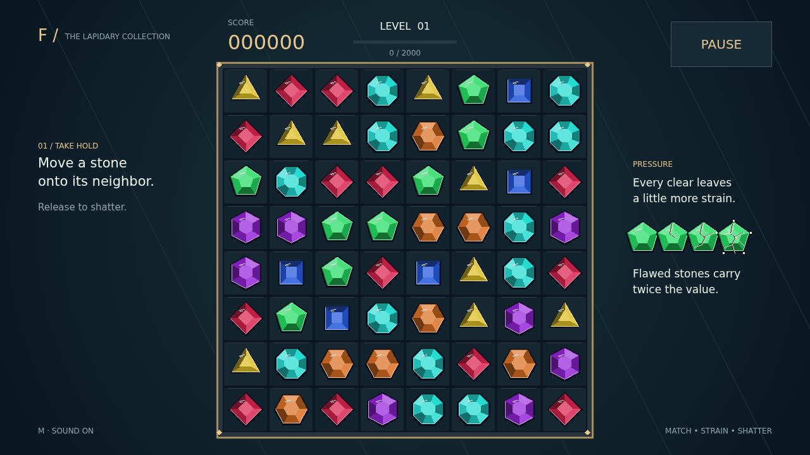

# Facet

Seven kinds of cut stone. One board under pressure. Take hold of a gem, carry it onto its neighbor, and let go to make a line of three or more. The stones shatter, fresh gems fall into the gaps, and a careful swap can become a whole cascade.

Every clear leaves strain in the stones beside it. A crack becomes a fracture, then a flaw. Touch a flawed stone with another clear and it shatters too, paying double and carrying the damage farther across the board. Build a fault line, then choose the moment to spend it.

Longer matches leave precious cuts behind. Four stones earn a brilliant that clears its surrounding ring. Crossing lines earn a star that tears through its row and column. Five or more leave a prism: swap it with a stone to shatter every gem of that kind.

Each step of a chain raises its reward. Fill the level meter, admire your longest chain and best move, then take on a fresh board with a higher target. Keep finding possibilities until no productive swap remains.

